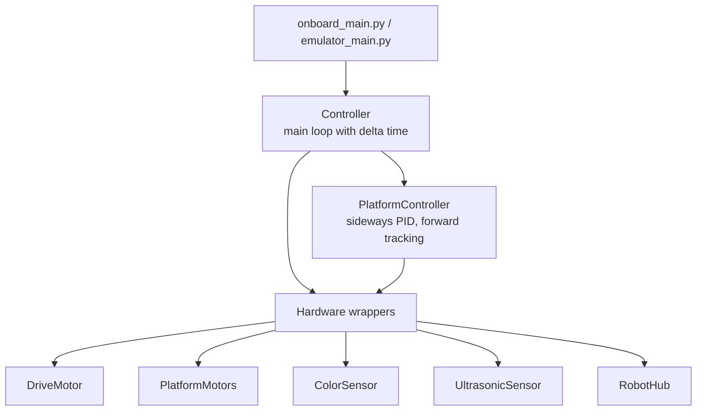

# Scuderia Cybernetica

Control software for a LEGO Mindstorms EV3 robot that drives on its own and keeps a platform on top
of it level in two axes. Written in Python for [Pybricks](https://pybricks.com/ev3-micropython/)
MicroPython as a team project.

The repository also contains a desktop emulator of the EV3, so the same control code can be run and
debugged in a browser without the brick.

## What the robot does

- **Drive:** one motor moves the vehicle at a constant target speed.
- **Level the platform sideways:** a colour sensor measures reflected light as the error signal and a
  PID loop drives the sideways platform motor.
- **Level the platform forwards:** an ultrasonic sensor measures the distance to a pendulum, which
  gives the slope the vehicle is on. A fitted curve maps that distance to the platform angle that
  compensates it; the value is smoothed and tracked by the forward platform motor.
- **Calibration:** on start the robot asks for a level reference and stores the sensor readings, so
  a run can also reuse the calibration of the previous one.

## Architecture



Every component implements `update(dt)`. The controller measures the time since the last cycle and
calls each component once per cycle, so control gains are independent of how fast the loop runs.
Hardware is wrapped in singletons, which keeps port assignments in one place (`config/ports.py`)
and all tunable parameters in another (`config/constants.py`).

| Path | Content |
|---|---|
| `onboard_main.py` | Entry point on the EV3 |
| `emulator_main.py` | Entry point for the desktop emulator |
| `software_ev3/controllers/` | Main loop and platform control |
| `software_ev3/hardware/` | Wrappers for motors, sensors and the hub |
| `software_ev3/config/` | Ports, constants, calibration data |
| `software_ev3/utils/` | PID controller, CSV logging, interpolation, calibration storage |
| `emulator_pybricks/` | Drop-in replacement for the `pybricks` package with a web UI |
| `data_plotter/` | Plots logged runs with Plotly |

## The emulator

`emulator_pybricks/` re-implements the parts of the Pybricks API the robot uses. Motors, sensors,
buttons and the battery become controls in a browser page, and everything the robot prints shows up
in a console panel. That made it possible to work on the control logic in parallel without the one
physical robot. Details are in [emulator_pybricks/README.md](emulator_pybricks/README.md).

```bash
python3 emulator_main.py
```

## Run on the EV3

1. Flash the EV3 with the Pybricks/ev3dev image and install the LEGO EV3 MicroPython extension for VS Code.
2. Connect the hardware as listed in `software_ev3/config/ports.py`.
3. Download the project to the brick and run `onboard_main.py`.
4. Put the platform level and the vehicle on flat ground, then confirm the calibration with the centre button.

## Logging and tuning

With `DATA_LOGGING_ENABLED = True` in `config/constants.py` the robot writes time series such as
target and measured speed to `robot_data.csv`. Plot a run with:

```bash
pip install pandas plotly
python3 data_plotter/plot_data.py robot_data.csv
```

## Team

Built by a team of students; see the commit history for the contributors.
